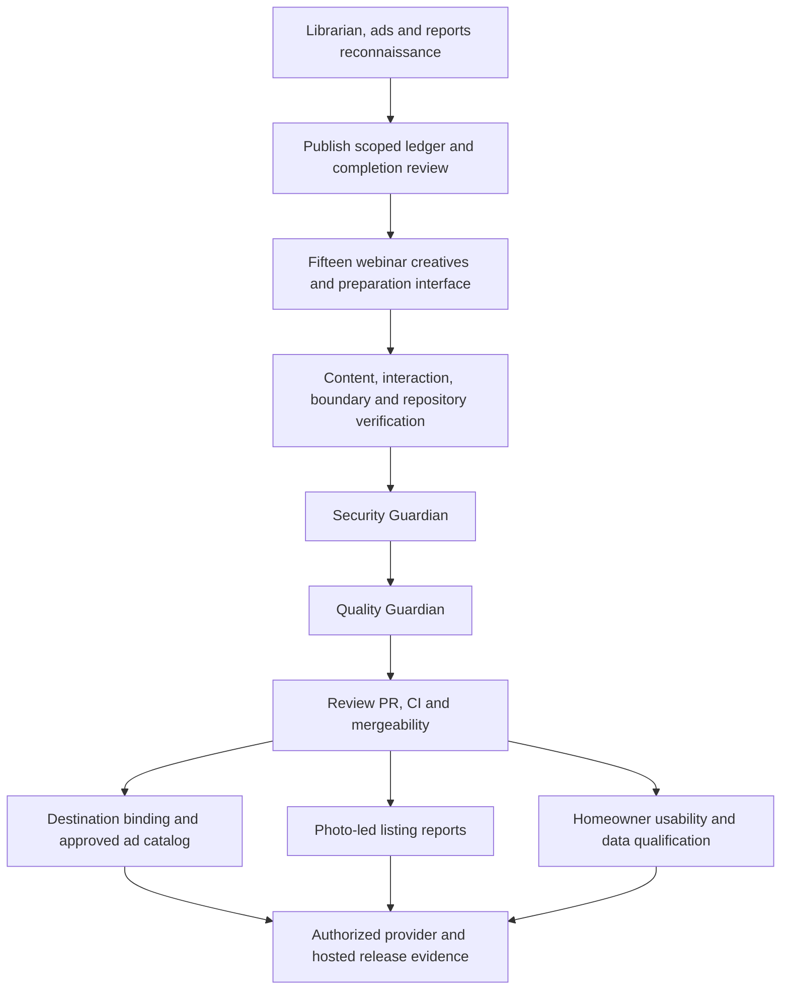

# Automated LO completion ledger

Date: October 13, 2026. Base: `origin/main` at `728d5f0`. Branch: `codex/completion-reconciliation`.

The owner requested a librarian review followed by Gauntlet execution, prioritizing fifteen webinar ads, listing marketing reports, and usable homeowner reports. This ledger tracks that new direction. Existing acceptance criteria and their evidence remain in `EXECUTION_LEDGER.md`, `PRODUCTION_EXECUTION_LEDGER.md`, and their source requirements; this document does not overwrite historical verification or declare those requirements complete.

## Current execution batch

The first batch is scoped to deliver a reviewable webinar ad pack inside the existing authenticated Ads library, clearer report entry points and the librarian review. It prepares original ads for review; it does not assert owner/lender approval, publish advertisements, spend money, or establish a working webinar destination. The complete customer outcomes below remain open until independently evidenced.

| ID                        | Exact acceptance criterion                                                                                                                                                                                                    | Status      | Owner                     | Evidence                                                                                                                                                                                    |
| ------------------------- | ----------------------------------------------------------------------------------------------------------------------------------------------------------------------------------------------------------------------------- | ----------- | ------------------------- | ------------------------------------------------------------------------------------------------------------------------------------------------------------------------------------------- |
| REVIEW-INVENTORY          | Reconcile the current requirements, code, open pull requests and release records into a source-linked librarian review, including the three owner priorities and specific remaining outcomes.                                 | VERIFIED    | library-guardian          | [Completion review](library/knowledge/private/product/completion-review-2026-10-13.md), current GitHub and source reconciliation.                                                           |
| WEBINAR-PACK-CONTENT      | Prepare exactly fifteen original first-time homebuyer webinar ad variants, with headline, primary text, creative art, and explicit correspondence to the existing webinar learning topics.                                    | VERIFIED    | react-guardian            | 15 unique entries, three per learning goal; final model tests and source review.                                                                                                            |
| WEBINAR-PACK-ART          | Each variant has two inspectable raster assets at the existing library art dimensions, with bounded size, derived paths and recorded byte digests; no invented advertiser identity or approval.                               | VERIFIED    | react-guardian            | 30 contained PNGs, dimensions/metadata/digests checked by model tests; total 1,427,006 bytes.                                                                                               |
| WEBINAR-PACK-PREPARATION  | The authenticated Ads library exposes the new pack, lets a user choose a variant, edit its words, inspect the result, copy the words and download its assets.                                                                 | VERIFIED    | react-guardian            | Final interaction tests plus root desktop/390px local choose/edit/on-demand/review smoke.                                                                                                   |
| WEBINAR-PACK-BOUNDARY     | Pending creatives remain separate from the approved catalog and cannot create an approved ad or reach the live launch workflow through the new preparation interface. Existing approved-library and sample guards still pass. | VERIFIED    | react-guardian            | Actual approval refusal test, unchanged approved catalog, zero network writes; sample build scan passed.                                                                                    |
| WEBINAR-PACK-VERIFICATION | Relevant content, interaction, art and boundary tests pass, alongside repository checks appropriate to the change.                                                                                                            | VERIFIED    | orchestrator              | Final production build, lint, format, audits and sample scan pass; 8/8 browser cases pass with zero axe violations. Broad 3,940 tests passed before final CSS; focused post-fix tests pass. |
| BATCH-SECURITY            | Security review runs after implementation, with no unresolved medium-or-higher findings in the batch.                                                                                                                         | VERIFIED    | security-guardian         | [Security review](library/requirements/reports/2026-10-13-completion-batch-security-review.md), zero unresolved Medium+ batch findings.                                                     |
| BATCH-QUALITY             | Quality review follows security and verifies every criterion in this batch against the actual changes; broader customer outcomes are reported separately.                                                                     | VERIFIED    | quality-guardian          | [Quality review](library/requirements/reports/2026-10-13-completion-batch-quality-review.md), zero unresolved findings in the scoped local implementation.                                  |
| BATCH-REVIEW-PR           | Commit and push the reviewed batch, open a PR, attach it to this chat, monitor checks, reconcile with current main and confirm mergeability.                                                                                  | IN PROGRESS | orchestrator              | Draft PR #90 is open and attached; reviewed baseline commit, final comparison CI and current-main mergeability qualification are pending.                                                   |
| REPORT-DISCOVERY          | Campaigns links clearly to the existing property campaign, financing report and funnel tools while preserving the ad action, keyboard access and honest draft/output language.                                                | VERIFIED    | typescript-node-guardian  | 30 Campaigns interaction tests, correct routes, keyboard order and unchanged ad action; root source recheck.                                                                                |
| DEPENDENCY-PATCH          | Remediate the fresh High Next.js image-optimization SSRF advisory with the smallest verified patched version, preserve audit policy, and rerun dependency/build/regression checks.                                            | VERIFIED    | dependency-audit-guardian | Next.js 16.3.8; package/lock aligned, signatures verified, audit and final build/tests pass.                                                                                                |

## Complete customer outcomes still required

| Outcome                             | Acceptance and source                                                                                                                                                                                                                                                                       | State | Dependency / required evidence                                                                                                                                           |
| ----------------------------------- | ------------------------------------------------------------------------------------------------------------------------------------------------------------------------------------------------------------------------------------------------------------------------------------------- | ----- | ------------------------------------------------------------------------------------------------------------------------------------------------------------------------ |
| Webinar ads ready for actual launch | Fifteen reviewed, branded ads use a selected published live or on-demand webinar destination; the saved destination is covered by approval; connection, launch, readback and attribution work. PRD-009d, PRD-001e/f, and the current owner direction extend the historically empty catalog. | OPEN  | New destination binding and qualification, reviewed real catalog entries, approved advertiser/provider setup, bounded launch authorization and actual provider readback. |
| Listing marketing reports           | A discoverable property workflow produces a photo-led report, printable flyer and responsive co-branded property page from identical saved facts, authorized media, both identities and verified financial inputs.                                                                          | OPEN  | PRD-010 `payment-flyers-and-co-branded-sites.md` PAY-001 through PAY-016; existing private text-only package is not sufficient.                                          |
| Usable homeowner reports            | Authorized property inputs produce a real dated valuation, mortgage/equity report, PDF and revocable share link, with refresh, review requests and delivery tested end to end.                                                                                                              | OPEN  | PRD-007, PRD-002e scoped subset, verified hosted configuration/data access, permitted lookup budget, retention/export/deletion and actual delivery evidence.             |
| Five finished funnel journeys       | Each selected journey supports branded saving, publication, actual visitor capture, gated next steps and accessible mobile presentation.                                                                                                                                                    | OPEN  | PRD-010 FUN-001 through FUN-012. Native platform-hosted capture is implemented; deployed outcome and conversion evidence are distinct.                                   |
| Customer domains                    | Customers connect and verify their own hostname, publish and submit successfully on it, with correct workspace routing, TLS, rollback and support states.                                                                                                                                   | OPEN  | Draft PR #87 has boundary code only and a failed application CI check. Preserve its files and do not treat its title as completion.                                      |
| HighLevel customer handoff          | Native inquiries and homeowner report actions reach the intended HighLevel location with correct consent, deduplication, retries and attribution, verified against actual records.                                                                                                          | OPEN  | Existing App Test/provider gates and exact authorized integration evidence.                                                                                              |
| Release qualification               | Required hosted migrations/configuration, authentication/recovery, data handling, provider gates, CI, deploy smoke and customer visual acceptance are evidenced for the release.                                                                                                            | OPEN  | Existing operator checklist plus current live checks. No configuration absence is inferred solely from an old doc.                                                       |

The [next-wave implementation plan](library/knowledge/private/product/completion-next-waves-2026-10-13.md) maps these open outcomes to existing criteria, shared contracts, file ownership, verification and specific external inputs. It is an executable plan, not evidence that those outcomes have shipped.

## Wave plan and model mapping

The Gauntlet's Cursor `/loop` maps to the native collaboration tools plus iterative verification in this Codex chat. Native Guardian definitions and paired Weapons are loaded. The managed model matrix contains Cursor/Claude identifiers that cannot be requested in this Codex session, so available inherited GPT-6 is used for bounded reconnaissance and implementation. Security and quality use separate fresh Guardian contexts, in that order. The user explicitly authorized this Gauntlet work, superseding older recovery notes asking for sequential inline work.

The first batch and the independently owned homeowner-readiness and financing-photo increments are assigned for mutation. Their exact subset criteria live in their separate execution ledgers. Remaining outcomes require bounded source criteria and implementation ownership before their respective waves; an open criterion never receives partial completion credit.

## Live access and external evidence

- The supplied hosted `/marketing/campaigns` URL redirected this browser to `/sign-in`. The owner was asked to sign in; authenticated click-through is pending. Local fixture navigation may help inspect UI but cannot prove hosted functionality.
- Read-only Vercel CLI inspection identified the current `operation-automated-lo-web` project and its production variable names. The inventory includes homeowner flags and allowance configuration but lists neither `OALO_RENTCAST_API_KEY` nor `OALO_HOMEOWNER_ALLOWED_LOCATION_IDS`. This is current configuration metadata, not a claim about deployed flag values or successful live lookups. The connector returned a scope error; the existing authorized CLI connection supplied the read-only fallback. No variable values were printed or changed.
- [Draft PR #90](https://github.com/jzferrell26/operation-automated-lo/pull/90) contains this batch and is attached to this chat. Initial CI run `38457279026` passed release/recovery and the underlying database steps, then failed the browser qualification: one broad status locator and screenshot comparisons for changed screens. Initial canonical Linux capture run `38458217895` exposed the card-margin defect during image review and was superseded by the corrected capture below. These initial failures remain recorded; they are not waived.
- Source correction `3004b5d` scopes the status assertion and resets both new report-card text margins after actual mobile image inspection. Security then Quality rechecked it. Corrected canonical Linux run `38462525903` passed both synthetic and real-account capture suites. UX accepted 56 intentional feature baselines and eight separately attributed approved-detail date-mask refreshes; unrelated image differences are excluded. Final comparison against those committed images remains pending at this checkpoint. Source-fix CI `38462510174` retained the expected old-baseline failures and an unrelated sign-in timeout; the passing same-head capture is separate evidence, not a waiver of final comparison.
- Independent next waves have begun from current main in isolated branches: `codex/homeowner-readiness` and `codex/financing-photos`. The former has implemented safe readiness states and preserved cached/saved-report actions with focused tests and a successful build; actual signed-in/real-PostgreSQL proof awaits CI because the local Docker engine is unavailable. The latter has a frozen engineering media/snapshot contract and a separately owned media implementation underway. Neither branch is included in this PR or claimed complete here.
- GitHub has zero open issues at reconnaissance time. Open PRs are #87 (custom-domain boundary), #88 and #89 (dependency updates). These are separate work; this batch does not change their files or branches.
- Global memory recall was attempted through read-only commands. The memory hook produced shell-incompatible output; the Bash fallback is unavailable. No memory-derived deployment claim is made. Relevant local memory has no project-specific takeover record that overrides the repository evidence.
- Reference sources: [Plai's campaign launch guide](https://help.plai.io/article/how-to-create-an-ad-campaign), [ListReports marketing kits](https://support.listreports.com/hc/en-us/articles/21574305007635-Marketing-Kits-Guide-for-Agents-and-Loan-Officers), [Homebot](https://homebot.ai/), and [myhomeIQ](https://www.myhomeiq.com/). These inform workflow outcomes, not copied source assets or claims of feature parity.

## Watchdog history

No terminations or decompositions at initialization. All three reconnaissance agents have reported useful source findings.

Comparison run 38469092751 at 42be9c2 passed Application verification and Release/recovery. Actual database steps passed, but the account browser comparison failed two additional approval timestamp mask-width baselines: launch step 3 approved at 390 Light and campaign-detail already-decided at 1440 Light. A bounded capture-only approval/save date normalization and future-date regression proof are underway. Final comparison remains open; the canonical write-mode success is not a waiver. Independent homeowner-readiness draft PR #91 is attached and running CI. Financing production upload failure was isolated to native Node environment parsing, with a separately tested cross-realm image boundary; actual repaired production/browser proof is pending.
