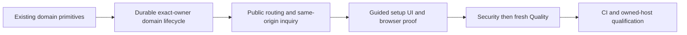

# Customer-domain completion

Root created this branch from current `origin/main` at728d5f0, then fast-forwarded the reviewed combined increment82cf5a2. An ordinary conflict-free merge reused the four committed PR87 primitives at5159b20a; new combined head6b7afbec. The original PR87 checkout and branch remain untouched.

The owner authorized project completion and Gauntlet execution. Current inherited GPT-6 is the available model route; historical matrix aliases are unavailable. Armed Guardians own disjoint files. Root owns this ledger, Git and CI. Security followed by fresh Quality closes each implemented packet.

| Criterion                                 | Owner and proof                                                                                                                                   | State                       |
| ----------------------------------------- | ------------------------------------------------------------------------------------------------------------------------------------------------- | --------------------------- |
| FUN-005 saved claim and setup             | Domain server owner: strict claims, server challenges, bounded provider checks, durable state and accurate DNS/TLS refusal                        | Assigned                    |
| FUN-006 exact owner and routing           | Same owner: no global pending-host reservation, one verified current owner, stale/disconnected/foreign host refusal, strict public-path allowlist | Assigned                    |
| FUN-004/FUN-009 host consumer subset      | Same owner: exact domain publication owner and same-origin inquiry/receipt behavior, original HighLevel delivery and consent unchanged            | Assigned                    |
| FUN-005/FUN-008 user flow                 | Later assigned UI owner: guided Settings Domains, accurate next steps, accessible retry/disconnect and actual browser proof                       | Pending server verification |
| FUN-011 setup timing                      | Later verifier: distinguish UI actions from DNS/hosting propagation, no fabricated completion timing                                              | Pending flow                |
| Full close-out                            | Security, then fresh Quality, current main ancestry/MERGEABLE and actual CI                                                                       | Pending implementation      |
| Controlled hosted DNS/TLS/visitor journey | Owned test hostname and existing authorized platform configuration after local source proof                                                       | Open release input          |

Reserved additive migration: `20261014060000_funnel_domains.sql`, verified absent before assignment. No other new numbered identifier is assigned here.

Platform-hosted URLs do not close customer-domain setup. Provider credentials do not replace missing source. Reuse current provider recommendation records, not a remembered CNAME. No domain purchase, nameserver/MX edits, force-transfer, existing redirect overwrite, account-wide deletion, live provider call or deployment is authorized by this local source ledger. The sole LO retains current owner controls; no new customer role administration is introduced.

## Frozen domain server packet

The source owner released eighteen files after67focused unit cases and a production build passing all16 workspace tasks. Independent Security then fresh Quality found no scoped source issues. Security independently passed77domain/legacy cases,13legacy proxy/auth cases andeight actual-handler probes; Quality independently passed90cases across11files andtheeight probes. Totals overlap and are not added. Security report SHA-256:8d9ce4002dca93f5ac92931754c9a68b4b06b5497388915e8941927e216fc843. Quality report SHA-256:af00fbc5ed1b6e59d987ff6629ce0e01e7d786820f325eeca681b197000045ec. All eighteen source pins and the root-transcribed handoff match both reviews.

Six real-PostgreSQL cases andeleven pgTAP checks are authored but unrun locally. ActualCI is mandatory. GuidedUI, autonomous rechecks, hostname-root default routing, setup timing andowned-host visitor proof remain pending. The source subset is reviewed; no fullFUN or live domain completion is recorded. Root now commits only the released server packet and starts its current-head CI, preserving the original PR87 branch.
