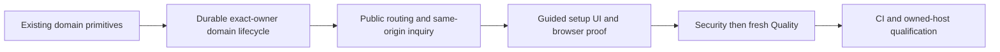

# Customer-domain completion

Root created this branch from current `origin/main` at728d5f0, then fast-forwarded the reviewed combined increment82cf5a2. An ordinary conflict-free merge reused the four committed PR87 primitives at5159b20a; new combined head6b7afbec. The original PR87 checkout and branch remain untouched.

The owner authorized project completion and Gauntlet execution. Current inherited GPT-6 is the available model route; historical matrix aliases are unavailable. Armed Guardians own disjoint files. Root owns this ledger, Git and CI. Security followed by fresh Quality closes each implemented packet.

| Criterion                                 | Owner and proof                                                                                                                                   | State                       |
| ----------------------------------------- | ------------------------------------------------------------------------------------------------------------------------------------------------- | --------------------------- |
| FUN-005 saved claim and setup             | Domain server owner: strict claims, server challenges, bounded provider checks, durable state and accurate DNS/TLS refusal                        | Assigned                    |
| FUN-006 exact owner and routing           | Same owner: no global pending-host reservation, one verified current owner, stale/disconnected/foreign host refusal, strict public-path allowlist | Assigned                    |
| FUN-004/FUN-009 host consumer subset      | Same owner: exact domain publication owner and same-origin inquiry/receipt behavior, original HighLevel delivery and consent unchanged            | Assigned                    |
| FUN-005/FUN-008 user flow                 | Later assigned UI owner: guided Settings Domains, accurate next steps, accessible retry/disconnect and actual browser proof                       | Pending server verification |
| FUN-011 setup timing                      | Later verifier: distinguish UI actions from DNS/hosting propagation, no fabricated completion timing                                              | Pending flow                |
| Full close-out                            | Security, then fresh Quality, current main ancestry/MERGEABLE and actual CI                                                                       | Pending implementation      |
| Controlled hosted DNS/TLS/visitor journey | Owned test hostname and existing authorized platform configuration after local source proof                                                       | Open release input          |

Reserved additive migration: `20261014060000_funnel_domains.sql`, verified absent before assignment. No other new numbered identifier is assigned here.

Platform-hosted URLs do not close customer-domain setup. Provider credentials do not replace missing source. Reuse current provider recommendation records, not a remembered CNAME. No domain purchase, nameserver/MX edits, force-transfer, existing redirect overwrite, account-wide deletion, live provider call or deployment is authorized by this local source ledger. The sole LO retains current owner controls; no new customer role administration is introduced.

## Frozen domain server packet

The source owner released eighteen files after67focused unit cases and a production build passing all16 workspace tasks. Independent Security then fresh Quality found no scoped source issues. Security independently passed77domain/legacy cases,13legacy proxy/auth cases andeight actual-handler probes; Quality independently passed90cases across11files andtheeight probes. Totals overlap and are not added. Security report SHA-256:8d9ce4002dca93f5ac92931754c9a68b4b06b5497388915e8941927e216fc843. Quality report SHA-256:af00fbc5ed1b6e59d987ff6629ce0e01e7d786820f325eeca681b197000045ec. All eighteen source pins and the root-transcribed handoff match both reviews.

Six real-PostgreSQL cases andeleven pgTAP checks are authored but unrun locally. ActualCI is mandatory. GuidedUI, autonomous rechecks, hostname-root default routing, setup timing andowned-host visitor proof remain pending. The source subset is reviewed; no fullFUN or live domain completion is recorded. Root now commits only the released server packet and starts its current-head CI, preserving the original PR87 branch.

## Guided UI and corrected CI fixtures, October 14

The Settings Domains consumer is released with strict API parsing, deliberate connect/disconnect, provider DNS records, HTTPS/freshness states, clipboard fallback, conflict reload and complete domain error copy. It uses the existing design tokens and wrappers. It preserves the stored default kind on reconnect and exposes no unimplemented hostname-root choice. No customer roles or QR manager are added.

Initial CI38523268542 passed all11 new domain pgTAP checks and four PostgreSQL cases. Two cases failed because artificial expiry used a runtime role without UPDATE permission and left a fixture claim behind. The repaired fixture retains an explicit42501 denial, uses the existing disposable-only privileged test helper for artificial expiry and cleans up both owners. The scaffold expects exactly32 tables and names the domain table while preserving all RLS/grant/index checks. The old UI error-code inventory failure is also fixed. Actual corrected CI is still required.

Fresh Security SHA-256: bc9a55d872ce2cdae77dc683c2dbd82503e3020a8fbb0e48decebf08aa2afe73. Fresh Quality SHA-256: 6af7318d02dfc56e7a6f0935d233aae39f3edba913379c088cfdf07d33ccd27e. All eighteen UI/correction packet pins match. Quality independently passed35 integration,55 client/catalog unit,42 adjacent domain unit andfour privilege checks; initial five-second inventory scan timeouts and their unchanged serial successful reruns remain recorded.

Four synthetic production-server browser cases passed at1440 and390 in Light/Dark with36 original frames, zero scoped axe violations and no overflow or external requests. Root inspected ten representative originals. This is partial visual evidence. Whole scored UX review,1180/768 domain frames, eight changed authenticated Settings canonical baselines, actual corrected PostgreSQL/full CI and controlled hosted DNS/TLS remain open. The ready fixture's missing checked-at timestamp is a representativeness suggestion, not real provider proof.

The read-only precommit repository check uses local clone and gh CLI: current main remains an ancestor, PR97 is MERGEABLE at its preceding source head, assigned migration and frozen source boundaries are intact, and CODEOWNERS/PR templates/locked CI remain. Root owns Git and this ledger. The draft increment is reviewable; it does not close the complete FUN contract.

## Complete review frames and local TLS routing

CI38531611437 at50c7e281 passed3180 unit cases but failed the exact page-title inventory and five internal terms in new customer copy. Root corrected only the explicit Domains title inventory and that copy. Eight browser cases now produce88 whole original frames at all four shared review frames in Light/Dark, including actual loading/error states. Independent UX reviewed all88 and closed DUV-01 after the screen adopted shared AsyncState for loading, error, restricted and degraded states. Closure SHA-256:c6b5678f07a54317a7002cc347835d7b81843a3022e49ebe1f9bc6147876da09; current manifestc5534f0060c027471105120f4adaaa66acd42169fdf5fb5fea60a72aa5ca7dc5. The previous72 originals and their manifest remain preserved.

The same CI database/browser job reached its90-minute limit and cannot qualify the current source. Its separate authenticated Settings baseline capture is still pending; eight changed Settings originals must be reviewed before adoption.

Installed Next16.3.8 constructs the internal request URL at its local listener port and normalizes127.0.0.1 to localhost, while the TLS gateway sends the configured public Host. The strict public routing boundary now recognizes only explicit HTTPS loopback aliases in local mode with an exact canonical raw Host; production and foreign/custom-private refusals remain strict. An actual native HTTP production probe returns200, CSP and143,808 image bytes for the canonical gateway, and empty404 responses for internal/foreign hosts. The earlier Node fetch probe ignored its supplied Host, so its gateway label was not valid gateway evidence; the corrected probe preserves that limitation.

Transport source SHA-256:95aefbc8b6174239f2d2207061cbb6fb44c3c47d5988fa624275f651c6a99c64. Regression SHA-256:036daffd60a73da5fd9a0e30eec5c3916e15b5de17cd30b2b90a67d250610b3a. Handoff SHA-256:7395baf718b3c8768f66368dbdbc2ab121067c334b2a7caddb228a6d55da4c10.44 focused cases and16 production build tasks pass. Autonomous rechecks, hostname-root default routing and controlled owned-host proof remain open.

Fresh combined Security02f709fb6902b769a89b1114cb4bbbd399d68fd0d51cc60639f623715b520508 passed98 cases and reproduced the exact native HTTP outcomes after retaining two unchanged early timeouts. Fresh Quality1424b607261995dce89f0fb10a79d04739c7b2a96697b9ee4f20fbc5df82233f then passed174 focused cases, TypeScript and the unchanged native probe. All eight source pins,88 current and72 retained image hashes matched. These overlapping review totals are not combined.

The completed old database/browser log confirms323 PostgreSQL cases in26 files, including six domain cases, passed before review-browser timeouts. The baseline workflow reached its100-minute limit and also records Docker registry429 data-limit refusals before browser execution. Its eight Settings files are byte-identical to the pre-Domains baseline, so no downloaded replacement is adopted. The routing repair is not established as the sole cause or cure. Raw log hashes and all limitations are retained in final Quality. New canonical CI and eight actually recaptured Settings originals remain mandatory.

Root's read-only precommit repository check uses local clone plus gh: current main remains an ancestor and the draft is MERGEABLE at50c7e281; assigned source/migration boundaries, CODEOWNERS, templates and locked CI remain unchanged. Root commits the frozen eight-source packet, review evidence and this ledger, then runs current-head CI and the existing baseline workflow. No production deployment, account change or live domain action occurs.

## Authenticated review fixture and approved Settings capture

At4209bbfe, canonical run38544891984 passed323 actual PostgreSQL cases and130 authenticated review-browser cases before the expected Settings image mismatch and a real webinar sign-in429. Application verification retained two obsolete three-card Settings inventory assertions. The separate baseline capture38544884852 passed154 browser cases, including the eight Settings captures, before a later webinar sign-in429; its overall failure remains a failure.

The fixture now reuses only actual successful setup sessions for webinar preparation. It validates the current identity through the existing server before accepting a run-scoped candidate, partitions actors, falls back once on an invalid candidate and cleans up its private temporary directory. The production20-attempt/900-second sign-in policy, counters, principals and headers remain unchanged. No cookie is manufactured. The exact inventory adds only Domains to the existing headings and links.

Independent UX approved all eight new Settings defaults and preserved the previous eight originals. Approval SHA-256:c3c386bc5ccd0807db5ad070d97281f6e179a4394c8162c48616636ce845a8e0. Only those eight canonical images are replaced; the total remains136. The inherited toolCard/Card source-policy discrepancy and the dated October3 F-11 composition ruling remain explicit, with no blanket source waiver.

Fresh Security d7f679576270f13e2bb670e004a9e1da009e4e60cf743ab0cc06ebcf7c7e34b5 precedes fresh Quality52a4333b75bdd52643d25f46f560e99050d07216b7c167120e4fdd17745c6a89. Quality independently passed204 checks and matched all seven source pins, prior production pins, eight new images and eight retained originals. These totals overlap author and Security runs. Actual browser session reuse and current-head canonical CI remain required.

The read-only local-clone/gh precommit check confirms origin/main728d5f0 remains an ancestor and PR97 is MERGEABLE at4209bbfe. Locked CI, CODEOWNERS, assigned migration and production source boundaries are unchanged. Root commits only the released harness, inventory, approved images, frozen reports and ledger. Autonomous rechecks, hostname-root default routing, setup timing and controlled owned-host proof remain open engineering or release work.
