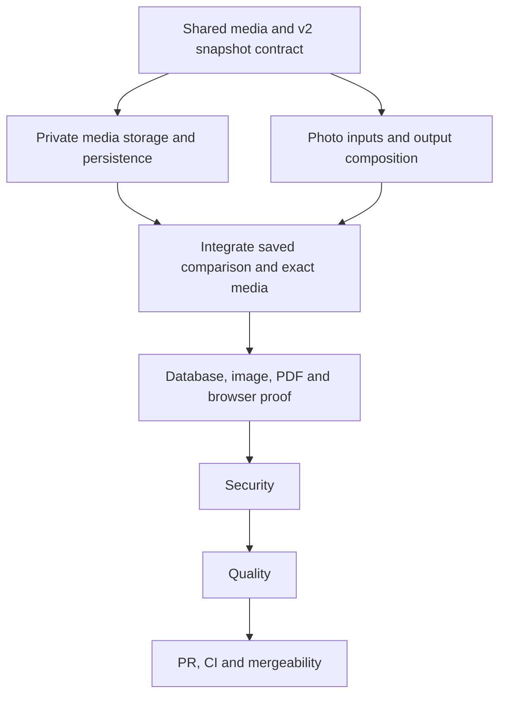

# Financing photo outputs execution ledger

Date: October 13, 2026. Branch: `codex/financing-photos`, from `origin/main` at `728d5f0`. This increment supplies the private photo-led financing/report/flyer/site subset of PRD-010. Public approval, sealed public QR/site, presets, identity portraits/logos and HighLevel delivery remain separately open.

| ID            | Exact acceptance criterion                                                                                                                                                                                                                                                                                                       | State    | Owner                           |
| ------------- | -------------------------------------------------------------------------------------------------------------------------------------------------------------------------------------------------------------------------------------------------------------------------------------------------------------------------------- | -------- | ------------------------------- |
| FP-CONTRACT   | Freeze one versioned media/snapshot agreement before parallel implementation, including ownership, rights, normalized hashes, private reads, legacy v1 compatibility and versioned v2 projection.                                                                                                                                | VERIFIED | contract-writing-guardian       |
| FP-MEDIA      | Authenticated bounded JPEG/PNG upload normalizes and validates decoded bytes, strips metadata, records explicit usage rights, stores private bytes and returns opaque media references. Tenant/role/CSRF checks reject foreign references, arbitrary keys/URLs and malformed/oversized/multiframe data. PAY-007, PAY-014 subset. | VERIFIED | storage/database implementation |
| FP-PERSIST    | Confirmed property facts and resolved media metadata are frozen with the saved v2 financing comparison. v1 still reads/renders unchanged, including old hashes. Failed or conflicting saves preserve the user's draft and never create a falsely ready package. PAY-008 subset.                                                  | VERIFIED | financing implementation        |
| FP-OUTPUT     | The actual private report, PDF and responsive site project identical saved amounts, labels, validity and property/media versions. Real image bytes appear in HTML and PDF; missing/corrupt/foreign media fail honestly. PAY-008 subset.                                                                                          | VERIFIED | financing output implementation |
| FP-LAYOUT     | An original photo-led three-scenario flyer/report, explicit four/five-scenario layout and responsive gallery preserve all rows/disclosures with long content at 1440, 1180, 768 and 390 in both themes. PAY-009 subset.                                                                                                          | VERIFIED | UX/output implementation        |
| FP-REGRESSION | Existing no-open-house creation, one-to-five scenarios and deterministic monthly/cash accounting remain tested. Actual PostgreSQL, image/PDF and browser checks pass for this scope. PAY-002 through PAY-004, PAY-015 and PAY-016 subset.                                                                                        | OPEN     | orchestrator                    |
| FP-SECURITY   | Security review runs after implementation with no unresolved Medium-or-higher findings.                                                                                                                                                                                                                                          | VERIFIED | security-guardian               |
| FP-QUALITY    | Fresh Quality follows Security and verifies exact implemented subsets and remaining complete-product criteria.                                                                                                                                                                                                                   | VERIFIED | quality-guardian                |
| FP-PR         | Reviewable commit/PR, required green CI, current-main conflict check and MERGEABLE status.                                                                                                                                                                                                                                       | OPEN     | orchestrator                    |

Source: `library/requirements/in-work/prd-010-campaign-recovery/payment-flyers-and-co-branded-sites.md` and `financing-report-increment.md`. No complete PAY-001/PAY-006/PAY-010-through-PAY-013 claim follows from these private subsets. Synthetic original fixtures permit implementation; actual media rights/storage/deployment and lender/public release evidence remain distinct.

Frozen engineering agreement: [CTR-001 revision 1](library/knowledge/private/contracts/CTR-001-financing-property-media.md), read and accepted by `/root` under the owner's delegated project authoring authority on October 13. It provides implementation-design acceptance only, not lender/public-release or owner visual approval. No runtime conformance is inferred from the contract's status.

## Contract dependencies

- [CTR-001 revision 1](library/knowledge/private/contracts/CTR-001-financing-property-media.md), Accepted. FP-MEDIA, FP-PERSIST and FP-OUTPUT pin this exact revision; incompatible changes require an accepted revision before consumer edits.

Reserved migration identifier, if an additive schema is necessary: `20261013210000_financing_media.sql`. No other numbered identifier is assigned. The contract owner defines the minimal schema before the database owner writes this migration and its tests.

Model mapping: available inherited GPT-6 for contract reasoning and bounded implementation. Native database/storage, TypeScript and UI Guardians use their configuration and paired Weapons. Security and Quality use fresh contexts in order. Unavailable historical model identifiers are not substituted silently.

Ownership: contracts are integrated sequentially. Database/storage owns the reserved migration, repository/media handlers and adapters. Financing input owns its save/read model and form. Output/UI owns HTML/PDF/report composition after contract handoff. The orchestrator owns this ledger. Agents touch only their assigned paths, do not revert another lane and do not enable a live provider or public release.

Final bounded source/local checkpoint: media, frozen v2 persistence, private output and responsive layout passed independent Security then fresh Quality, including the final FP-QA-01 correction. Explicit zero-photo v2 output no longer constructs photo storage; nonempty and malformed media remain strict. Independent Quality's39 recheck closed FP-QA-01. Source HTML/PDF/CSS and frozen CTR-001 hash remained unchanged after that boundary correction, preserving the reviewed32PNG/eightPDF and final eight-frame production browser evidence. The prior broad run passed275 files/3980 tests with one existing skip; it predates the final four-file boundary correction and is not credited as a post-fix full run. ActualJPEG/PNG201/replay200/privatechecksum409/410 lifecycle and eight existing report/accounting/reuse journeys passed separately. Production16-task build, type/lint/format/boundary/type/secret/duplication checks passed; the final boundary correction has39 focused tests and scoped gates. FP-REGRESSION and FP-PR remain open for actual PostgreSQL/18 new pgTAP assertions, integrated CI and current-main mergeability. Hosted R2, genuine photograph rights, owner/lender/fullD9, presets, identity images, public sealed QR/site and HighLevel delivery remain open. This branch is being stacked on PR90 for the already reviewed security patch and deterministic canonical captures; the exact financing scope remains separate.

The first CI run, 38483753309 at `bab5819`, executed the media migration. All 18 new media pgTAP assertions and three financing-media PostgreSQL cases passed. Aggregate database qualification failed: the scaffold expected 29 instead of 31 tenant tables after the two additions, and two of 300 route cases failed when a revoked-photo history candidate constructed an unavailable R2 runtime during otherwise permitted text-only reuse. The Database Guardian corrected only the context boundary, its v2 mixed-history regressions and the exact scaffold count. The regression failed before the source correction; afterward, 63 focused tests passed. Security independently passed the same 63 tests and pinned all three files. Fresh Quality and a complete PostgreSQL and CI rerun are required. No earlier failure is waived and no hosted storage or provider proof is claimed.
