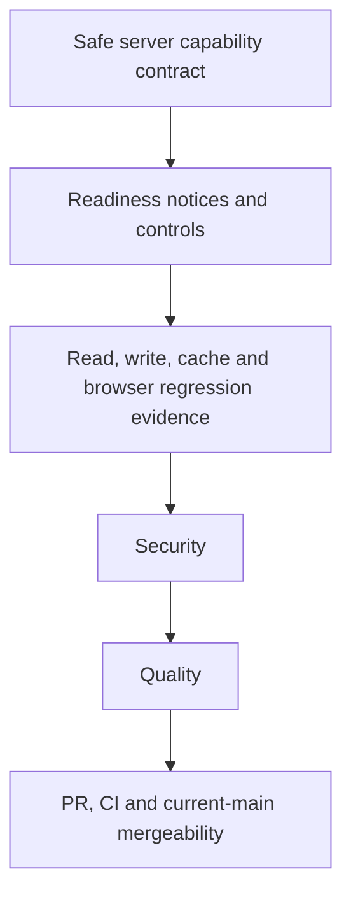

# Homeowner readiness execution ledger

Date: October 13, 2026. Branch: `codex/homeowner-readiness`. Base: current `origin/main` at `728d5f0`. This isolated increment implements the homeowner readiness work identified during the librarian review. It does not claim live valuation activation or completion of PRD-007's external criteria.

| ID             | Exact acceptance criterion                                                                                                                                                                                                                                                              | State    | Owner                    |
| -------------- | --------------------------------------------------------------------------------------------------------------------------------------------------------------------------------------------------------------------------------------------------------------------------------------- | -------- | ------------------------ |
| HR-STATE       | An authenticated, server-derived read model distinguishes unavailable report storage, lack of write authority, valuation setup unavailable and configured-zero/exhausted allowance. Unknown/error states are explicit. It exposes no credentials or internal configuration identifiers. | VERIFIED | typescript-node-guardian |
| HR-ACTIONS     | Create, refresh and monthly controls explain actual capability and the next useful action, without changing provider flags, allowances, roles or delivery consent. Cached/reused valuations and saved-snapshot edits retain their existing permitted behavior.                          | VERIFIED | typescript-node-guardian |
| HR-READS       | Unavailable new valuations do not hide or disable permitted saved snapshots, PDF export or existing sharing controls. Unauthorized reads/writes remain refused on the server.                                                                                                           | VERIFIED | typescript-node-guardian |
| HR-DESTINATION | The unavailable-valuation notice no longer sends users to the unrelated HighLevel/Meta connection screen. It gives an accurate operator/support next step using existing product conventions.                                                                                           | VERIFIED | typescript-node-guardian |
| HR-PROOF       | Focused readiness-permutation, failure-recovery, role and saved-report regression tests pass. Relevant repository gates and actual browser checks cover changed states. Hosted/provider proof stays separate.                                                                           | OPEN     | orchestrator             |
| HR-SECURITY    | Security review follows implementation, with no unresolved Medium-or-higher findings.                                                                                                                                                                                                   | VERIFIED | security-guardian        |
| HR-QUALITY     | Fresh Quality review follows Security and verifies the exact implemented criteria and their limits.                                                                                                                                                                                     | VERIFIED | quality-guardian         |
| HR-PR          | Reviewable commit/PR, required green CI, current-main conflict check and MERGEABLE status.                                                                                                                                                                                              | OPEN     | orchestrator             |

Source: PRD-007 acceptance items 1, 2, 4, 5, 8 and 9, its October 1 independent reviews, and `docs/operations/homeowner-avm-activation.md`. L-5 contact scope, L-15 retention/export/removal and L-16 financial-snapshot role decisions remain unchanged and open. No new migration or numbered PRD is assigned.

Model mapping: bounded implementation uses the available inherited GPT-6 model and native TypeScript/Node Guardian configuration. Security and Quality use fresh Guardian contexts, sequentially. The managed matrix's unavailable historical model slugs are not requested.

File ownership: implementation owns narrowly selected homeowner server/read-model, feature/copy and affected tests. It does not edit financing, campaign/catalog, domain or provider configuration files. The orchestrator owns this ledger; reviewers own their assigned reports. Shared files require an explicit handoff before mutation.

Source criteria HR-STATE, HR-ACTIONS, HR-READS and HR-DESTINATION passed independent Security and fresh Quality review. Focused tests and local production build passed. HR-PROOF remains open until actual CI PostgreSQL tests and the new signed-in browser presentation suite execute and retained frames are inspected. The browser uses synthetic report API fixtures inside the authenticated seeded shell. HR-PR remains open until required CI and current-main mergeability pass. See the October 13 readiness Security and Quality reports in PRD-007's reports folder.
