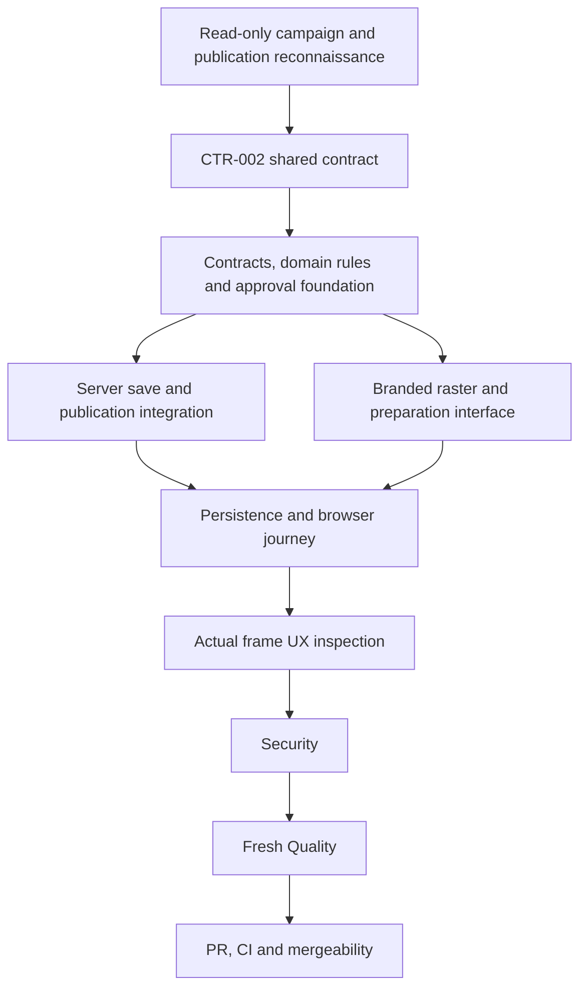

# Webinar launch readiness execution ledger

Date: October 13, 2026. Branch: `codex/webinar-launch-readiness`, created from `origin/main` at `728d5f0` and stacked on the verified source in PR #90 at `5eb7fef`.

This increment connects the fifteen prepared original webinar creatives to saved tenant campaigns, published webinar destinations and real review. Live provider execution requires its existing release gates and actual spend authorization. Preparation alone does not establish lender approval.

| ID          | Acceptance criterion                                                                                                                                                                                                                              | State    | Owner                     |
| ----------- | ------------------------------------------------------------------------------------------------------------------------------------------------------------------------------------------------------------------------------------------------- | -------- | ------------------------- |
| WA-CONTRACT | A source-grounded accepted contract defines template eligibility, publication ownership and immutable destination identity, actor provenance, approval drift and compatibility with existing campaign versions.                                   | VERIFIED | contract-writing-guardian |
| WA-SAVE     | A permitted user can save a selected prepared creative with confirmed brand, shape, words and a server-resolved published live/on-demand webinar destination. Cross-workspace and browser-supplied approval or destination overrides are refused. | OPEN     | implementation guardian   |
| WA-ART      | A saved creative produces branded raster output in the two required shapes, bound to the reviewed content and actual destination, with all existing disclosures retained.                                                                         | OPEN     | implementation guardian   |
| WA-REVIEW   | The existing real reviewer workflow covers the material template, art, brand, words and destination. Edits, withdrawal and retirement prevent stale approval or launch. Legacy catalog approval stays truthful.                                   | OPEN     | implementation guardian   |
| WA-JOURNEY  | Actual browser and persistence tests prove choose, bind, save, return, review and blocked/eligible launch states. The presentation works at four supported frames in Light and Dark.                                                              | OPEN     | browser and UX guardians  |
| WA-SECURITY | Independent Security finds no unresolved Medium-or-higher issue in the bounded change.                                                                                                                                                            | OPEN     | security-guardian         |
| WA-QUALITY  | Fresh Quality verifies the implemented contract and criteria after Security.                                                                                                                                                                      | OPEN     | quality-guardian          |
| WA-PR       | A reviewable PR has required green CI, current-main reconciliation and MERGEABLE status.                                                                                                                                                          | OPEN     | orchestrator              |

## Waves and model choices

Each lane uses the available inherited GPT-6 model. The managed matrix's historical unavailable identifiers are not requested. Contract and integration design use the current reasoning model; bounded implementation and mechanical evidence remain separate scoped Guardian tasks.

Root owns this ledger and integration sequencing. The contract agent owns only CTR-002. The database lane owns the reserved migration `20261013230000_webinar_ad_destination.sql` and its narrow publication boundary. Foundation, server, raster and UI lanes own their assigned source modules. Packaging owns bounded runtime tracing and CI evidence retention. Agents must preserve each other's active work.

The user delegated project authorship and authorized the Gauntlet, including parallel armed Guardians. This supersedes the older sequential recovery note for this task. Repository implementation does not establish owner visual acceptance, publication authorization, licensed valuation access, lender review or live Meta execution.

CTR-002 revision 2 is accepted under delegated engineering authority and pinned in both affected PRD dependencies. Root independently read the complete terms and confirmed SHA256 `47dba3f41499d50141c2bfc5a3a7f67468524d4a3f39a1f96a8506b8ac957f28`. The fifteen defaults fit the 60/300 bounds and passed seven existing conservative-claim/source tests. The structural validator accepts the record but its dependency scanner reports four false matches from the linked label and filename without a revision, despite the adjacent exact `CTR-002 revision 2` pin in both sections. Preserve those real links and disclose the validator limitation. No implementation credit follows from contract acceptance.

The foundation Guardian owns only campaign contracts/exports/tests, domain webinar rules/context/tests, and application version/approval/evidence helpers/tests. It adds explicit webinar variants and a mandatory authoritative evidence port for decisions and replay while preserving legacy signatures and hashes. Server/database and UI/raster ownership will be assigned after the typed foundation seam is stable. No placeholder production validator is permitted.

## Implemented source awaiting independent close-out

All implementation lanes have released their source. The strict additive webinar manifest, current evidence rules and decision/replay port preserve legacy campaign compatibility. Server save derives brand, publication identity and real branded PNG evidence before appending a version. Exact retries recover the original version, including an interrupted preflight write; incomplete saves cannot be approved. Private historical review reads use the saved version boundary, while current approval checks withdrawal, expiry and drift. The UI retains a bounded original request for uncertain retries, refuses unauthorized stale body display, and gives explicit version choices after conflicts. These source claims remain subject to independent Security and fresh Quality.

Local evidence: foundation27 new tests and808 combined legacy/foundation cases; publication16 server and4 repository tests; server129 unit cases across9 files; renderer23 actual native PNG tests; packaging13 tests; UI82 integration cases with one existing skip,11 pending-save boundary cases and15 final preparation cases. These overlap and are not added into a unique total. Eight local production browser cases retained24 original synthetic preparation frames. Raster evidence contains32 actual generated PNGs. Independent UX is inspecting all56 images. None proves live lender acceptance or a provider launch.

Actual PostgreSQL qualification remains open: the new migration has28 authored pgTAP assertions, six publication-boundary cases and five exported HTTP journey cases. Eight seeded-account browser cases are authored for the real saved journey, with24 planned retained screenshots and16 downloaded PNGs. Local Docker is unavailable, so none of these database-backed cases is credited until CI runs them.

Production packaging passed all16 build tasks. The eight required consumer traces include34 precise runtime files and native Sharp; ten descendant traces also include the bounded files because of Turbopack tracing behavior. Actual relocated app-root and monorepo-root reads preserved every source hash. This is deployment packaging evidence, not execution in a hosted function. DevOps is adding bounded, always-retained CI artifacts without changing events, permissions or test gates.

Security identified a historical-output lifecycle issue: current template registry eligibility was incorrectly required when regenerating an authenticated saved version's frozen art. The assigned correction separates historical frozen-file verification from current preparation/approval checks, with actual native regression tests. Current review therefore remains OPEN; no clean source verdict is claimed before that fix and fresh Quality.

The historical-output correction passed test-first native regression and independent Security re-evaluation. An exact historical-save result path was also rejected incorrectly by the UI schema; root corrected only its boundary and ten meaningful cases. That regression failed before correction, then passed. Security's focused recheck passed21 unit and24 UI cases. Broad Security recorded196 unit,79 integration and4 adapter passes, one existing skip, zero production dependency vulnerabilities and exact source pins. Counts overlap and are not combined.

Independent UX individually inspected all32 rasters and24 original preparation captures and found no blocking visual defect in those images. Their filenames did not independently prove the editable form or open popup. Sixteen additional actual diagnostic frames filled those states, and all eight cases exposed one moderate unfiltered axe region finding: the portalled Published webinar listbox sat outside a page landmark. Quality correctly left WQ-01 and clean close-out OPEN. The React Guardian owns a minimal shared Select correction, its meaningful behavioral regressions and the existing browser test's open-state assertions/captures. Original RED evidence remains retained. A fresh production build and eight browser cases must verify the correction without excluding the rule; independent Security then fresh Quality must recheck it. No earlier clean verdict qualifies the new source automatically.

WQ-01 is now closed for the corrected source: all16 production build tasks, eight actual browser cases with unfiltered open-popup axe and11 independent modal/Select regressions passed. UX individually inspected all40 new preparation originals; Security then fresh Quality independently verified all image hashes and updated source pins. This proves bounded synthetic presentation and preserves the pending real saved journey.

The complete six-project regression passed4089 cases, skipped one existing case and failed six cases in five files. The actual failure log is retained. Corrections are assigned for plain user language, five unmapped emitted error codes, the exact preparation API inventory, complete rule-map inventory and precise fixed-tuple image-summary classification. Publication and Meta default-off assertions remain strict, and legacy empty-image guards must remain falsifiable. Full-wave Quality stays OPEN. After these corrections, repeat appropriate full regression, refresh changed presentation evidence, then Security and fresh Quality.

## Final local source qualification

All six regression failures were reproduced before the correction and are now closed. The route inventory adds only the preparation API, the complete rules map covers the actual registry, five emitted errors have plain sentence pairs, and strict fixed-tuple image consumers no longer inherit legacy empty-property-photo assumptions. Empty/malformed webinar tuples and a planted legacy image read in the same webinar file remain rejected. No publishing, request schema, authority, raster recipe or provider behavior changed.

The final complete six-project run passed283 files and4103 tests, with one existing skip. A fresh production build passed all16 tasks and compiled the current Next app; the existing eight browser cases passed unchanged in50.7 seconds. Forty originals were captured after that build. Independent UX inspected them, with explicit downsampling limits for four long selection views and no saved-review visual claim. Security independently passed127 affected cases, checked all ten correction and14 capture source pins and all40 original hashes, and found no new issue. Fresh Quality independently passed127 affected cases, matched80 superseding source pins and all current capture/log hashes, and cleared the bounded source with WQ-02 as a nonblocking suggestion. WQ-01 remains closed. Reviewers' selected counts overlap and are not combined.

The source is clear for a draft commit/PR and actual CI qualification. WA-SAVE, WA-REVIEW and WA-JOURNEY cannot become fully VERIFIED until the authored PostgreSQL and real saved-review browser journeys run. The latest saved-review and approval prose still needs those actual retained CI frames. The current local preparation context is synthetic; no customer save, publication, lender approval or provider launch is credited. WA-SECURITY and WA-QUALITY have bounded source clearance; their release qualifications remain tied to the new CI evidence. No overall PRD or project completion is claimed.

PR94 first App CI38498931146 failed the unchanged100% application coverage requirement with3003 passing unit tests. Only three meaningful existing foundation test cases were added, covering unexpected validation errors and stale stored approval hashes at first decision/replay. The full unit run now passes3006 tests across200 files; all16 application source files have100% lines/statements/branches/functions. Production source and thresholds are unchanged. Independent Security then fresh Quality each reran30 foundation cases and verified source pins and retained RED/GREEN coverage. Actual PostgreSQL and canonical runs at679ce978 continue. Corrected-head CI remains required.
